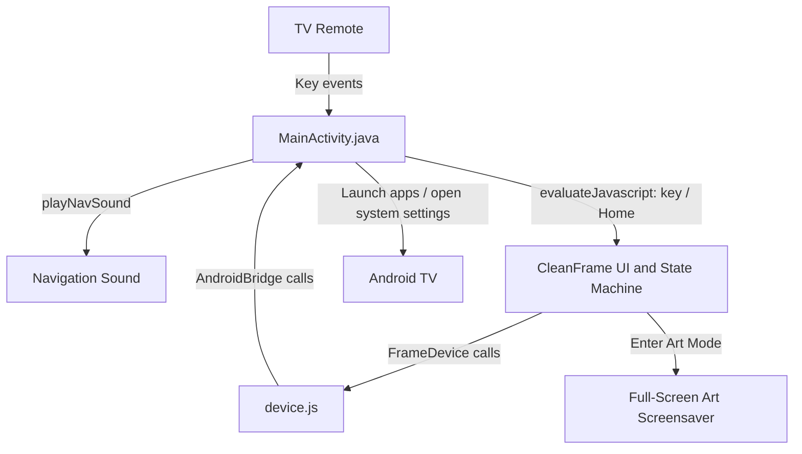

# CleanFrame for Android TV & Google TV

<p align="center">
  <b>A quiet, distraction-free home launcher with an art-focused screensaver, remote D-Pad navigation, and DPR auto-scaling for Android TV.</b>
</p>

<p align="center">
  
  
  
  
</p>

---

## Overview

**CleanFrame Android TV** is an open-source, ultra-minimalist home launcher designed specifically for Android TV and Google TV devices (such as Xiaomi Mi TV, Chromecast with Google TV, Sony Bravia, Nvidia Shield, and TCL TVs).

Ported from [Nathan Clark's CleanFrame](https://github.com/nthnclrk/CleanFrame) (originally built for Samsung The Frame on Tizen), this project brings the same serene aesthetic, Bing-powered art gallery, and zero-distraction interface to the Android TV ecosystem.

---

## Screen Preview

| Network Settings | Direct Google Play Store Integration |
| :---: | :---: |
|  |  |

---

## Key Features

- **Quick Wi-Fi & Ethernet Network Settings**:
  - Dedicated status icon situated directly to the left of Art Mode.
  - Clicking it immediately launches the native Android TV *Network & Internet* list for fast Wi-Fi connection switching and configuration.
  - Automatically detects active network type (Wi-Fi vs Ethernet).

- **Bing Backgrounds and Rotation**:
  - Choose a **Random Bing photo**, **Light**, or **Dark** background in **Settings → Background → Background type**. The Bing catalogue uses the [Bing UK weekly feed](https://raw.githubusercontent.com/zigou23/Bing-Daily-Wallpaper/refs/heads/main/bing/weekly/bing_en-GB.json) and is refreshed when its cached copy is more than a day old.
  - Rotation can keep the current photo, choose one when CleanFrame starts, or change it every 5, 15, or 60 minutes while Home is visible. Opening or restarting Home preserves the current Bing photo. When a feed update brings a different newest photo, it is shown first; rotation then resumes random selection.
  - Bing photos load separately from the catalogue. If a photo cannot be loaded, CleanFrame keeps the last loaded image; first launch uses a solid-color fallback.
  - **Focus → Material** (Soft, Frost or Clear tint) works with Bing backgrounds by blurring the live photo. The Home dock also blurs the current Bing background.

- **Full-Screen Art Mode Screensaver**:
  - Hides the dock, status text, clock, and overlays for a full-screen artwork.
  - Art Mode always shuffles Bing photos every 45 seconds and shows photo credits, regardless of the Home background.
  - Press **Left** or **Right** to browse artworks. Any other key returns Home; the selected photo is saved as the next Bing Home image without changing a Light or Dark Home background.
  - Starts automatically after 3 minutes of inactivity on Home.

- **Navigation Sound**:
  - **Settings → Sound → Navigation sound** sets the remote-navigation tick to Off, 2%, 5% (default), 10%, 25% or 50% of the TV media volume. Choosing a level plays a preview and is remembered across restarts.

- **Universal Display Scaling (720p / 1080p / 4K)**:
  - Engineered with real physical display geometry and `devicePixelRatio` compensation.
  - Scales the interface for 720p, 1080p, and 4K displays.

- **Smart Google Play Store Redirection**:
  - If a highlighted streaming app (Disney+, Prime Video, Stremio, Netflix, Spotify) is not yet installed, clicking its card directs straight to the official Google Play Store (`com.android.vending`) install page instead of showing an error.
  - Fixes regional package discrepancies (e.g., official global `com.disney.disneyplus`).

- **Photographic Wallpapers & Frosted Glass**:
  - 15+ bundled offline high-resolution artworks (Misty Coast, Quiet Cove, Mountain Valley, Forest Mist, Golden Peak, Alpine Horizon, etc.).
  - Pre-rendered optic glass blur and adaptive contrast ink.

- **Native Android TV Leanback Integration**:
  - Declared as `CATEGORY_LEANBACK_LAUNCHER` and `CATEGORY_HOME`.
  - Supports remote D-pad navigation (Up, Down, Left, Right, OK, Back) and a configurable navigation sound.
  - Pressing the remote's **Home** key returns to CleanFrame's Home screen from any CleanFrame view.

- **Apps on Home Editor**:
  - Add or remove Home shortcuts without installing or uninstalling apps.
  - Clear the Recently removed section independently from installed apps.

- **Settings**:
  - Settings rows share the available vertical space and resize to keep the last option clear of the on-screen navigation hint.

---

## Architecture



### Bridge Methods (`AndroidBridge`)

- `launch(packageName)`: Resolves package and launches Leanback / standard intent, or redirects to Play Store.
- `openHdmi(port)`: Switches TV input to HDMI 1 via Android TV Input Framework.
- `openSettings()`: Opens native Android TV system settings.
- `openNetworkSettings()`: Opens native Android TV Network & Internet settings.
- `enterArtMode()`: Triggers full-screen art screensaver.
- `getInstalledAppsJson()`: Queries installed TV apps dynamically.

---

## Getting Started

### Prerequisites
- Android Studio Ladybug / Meerkat or Android SDK command-line tools.
- A TV running Android 9.0 (Pie) or newer with ADB debugging enabled.

### 1. Clone the Repository
```bash
git clone https://github.com/ravizikrillah/CleanFrame-AndroidTV.git
cd CleanFrame-AndroidTV
```

### 2. Build the Debug APK
```bash
./gradlew assembleDebug
```
The compiled APK will be generated at:
`app/build/outputs/apk/debug/app-debug.apk`

### 3. Install on TV via ADB
Connect to your TV over Wi-Fi or USB:
```bash
adb connect <YOUR_TV_IP>:5555
adb install -r app/build/outputs/apk/debug/app-debug.apk
```

### 4. Launch the App
```bash
adb shell am start -n com.example.tv/.MainActivity
```

---

## Setting as Default Home Launcher

1. Press the **Home** button on your TV remote.
2. Android TV will prompt you to select the default launcher.
3. Choose **CleanFrame** and select **Always**.

*(To revert at any time, go to TV Settings → Apps → Special app access → Default home app, or uninstall the APK via `adb uninstall com.example.tv`)*.

---

## Project Structure

```
CleanFrame-AndroidTV/
├── app/
│   ├── src/main/
│   │   ├── AndroidManifest.xml          # Leanback launcher declaration
│   │   ├── java/com/example/tv/
│   │   │   ├── MainActivity.java        # Core Activity & JavaScript bridge
│   │   │   └── TvInputHelper.java       # HDMI Input switching logic
│   │   ├── assets/cleanframe/
│   │   │   ├── index.html               # CleanFrame TV stage markup
│   │   │   ├── main.js                  # Scaling, state machine & Art Mode
│   │   │   ├── device.js                # Android TV hardware bridge
│   │   │   ├── style.css                # Visual design, transitions & typography
│   │   │   └── assets/                  # Fonts & icons
│   │   └── res/                         # Android icons, sounds & layouts
├── gradle/                              # Gradle wrapper and version catalogs
├── build.gradle.kts                     # Root build configuration
└── settings.gradle.kts                  # Project settings
```

---

## Credits & Acknowledgments

- **[Nathan Clark](https://github.com/nthnclrk)**: Original creator of [CleanFrame for Samsung The Frame](https://github.com/nthnclrk/CleanFrame).
- **Fonts**: Manrope, Geist, and Newsreader (Open Font License).

---

## License

This project is licensed under the [MIT License](LICENSE).
